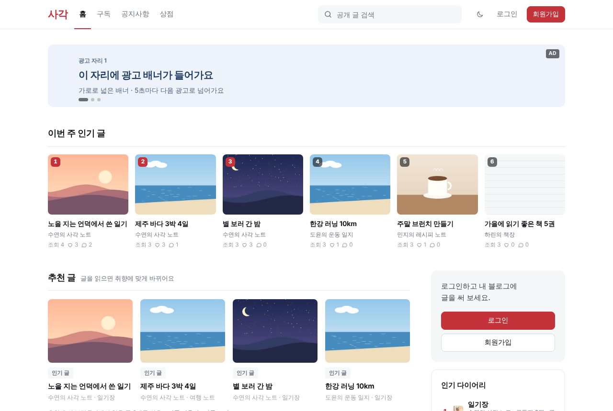
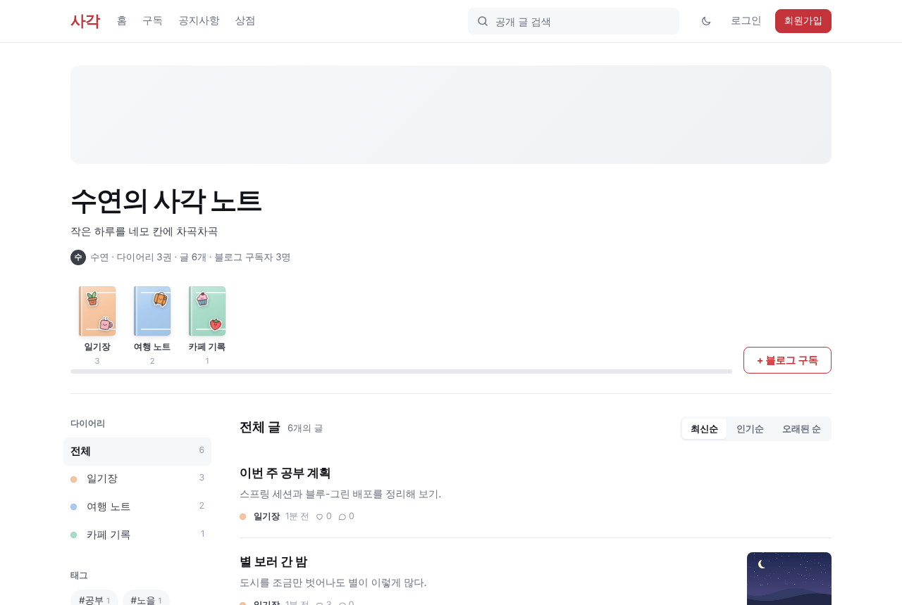
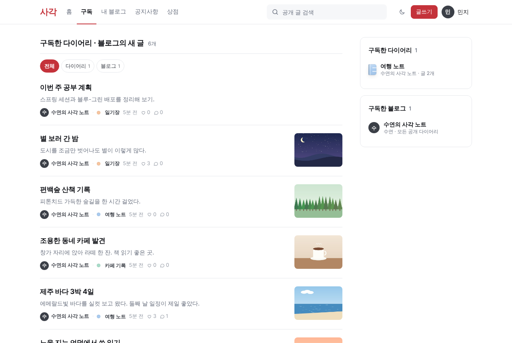
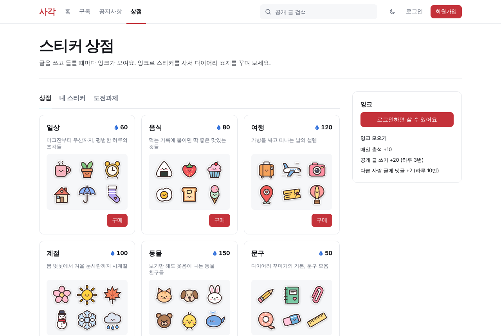
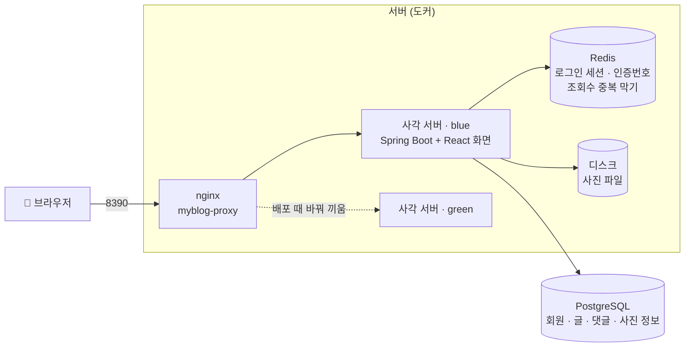
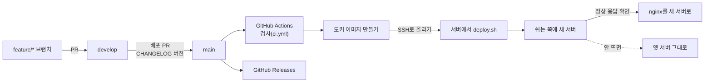

<div align="center">

# 사각

**여러 회원이 각자 블로그를 하나씩 운영하는 다이어리형 블로그 서비스**


</div>

| 항목 | 내용 |
|---|---|
| 사이트 | **https://sagak.java21.net** |
| 현재 버전 | v1.9.2 ([CHANGELOG](CHANGELOG.md)) |
| 기간 | 2026.10.08 ~ 진행 중 |
| 인원 | 1명 (기획 · 설계 · 백엔드 · 프론트엔드 · 배포) |
| 개발 저장소 | [home-my-blog/myblog](https://github.com/home-my-blog/myblog) (PR · 이슈 · 릴리스 기록) |
| 문서 | [home-my-blog/docs](https://github.com/home-my-blog/docs) (기능 설명 · 동작 원리 · API · ERD) |
| 요구사항 · 스펙 | [`specs/001-blog-core/`](specs/001-blog-core/) |
| 협업 방식 | AI 코딩 에이전트(Claude Code)와 함께 개발. 요구사항 → 스펙 → 작업 목록(spec-kit)으로 쪼개고, 모든 변경을 PR로 받아 검토 후 merge |

## 소개

사각은 "내 다이어리를 꾸미며 쓰는 블로그"예요. 회원마다 블로그가 하나 생기고, 블로그 안에 다이어리(분류)를 여러 권 만들어 글을 써요.

- **글쓰기**: 마크다운 에디터, 사진 올리기, 임시저장(60초 자동), 공개 · 구독자만 · 비공개
- **읽기와 소통**: 댓글, 좋아요, 블로그 · 다이어리 구독, 책갈피 폴더
- **찾기**: 분야별 글, 통합 검색, 실시간 인기 검색어(5초마다 갱신)
- **꾸미기**: 활동하면 잉크가 모이고, 잉크로 스티커를 사서 다이어리 표지를 꾸며요. 도전과제, 야간모드
- **회원**: 이메일 인증 가입, 비밀번호 찾기, 탈퇴 후 30일 안에 복구

| 메인 | 블로그와 다이어리 |
|---|---|
|  |  |
| **구독** | **스티커 상점** |
|  |  |

<sub>예시 데이터를 넣은 로컬 환경에서 찍은 화면이에요.</sub>

## 기술 스택

| 영역 | 사용한 것 |
|---|---|
| 화면 | React 19, TypeScript, Vite, TanStack Query, react-markdown |
| 서버 | Java 21, Spring Boot 3.5, Spring Security, Spring Session, JdbcClient |
| 데이터 | PostgreSQL 16 (pg_trgm 검색), Flyway(DB 변경 이력), Redis 7 |
| 배포 | Docker, GitHub Actions(CI/CD), nginx 블루-그린 무중단 배포 |
| 협업 | Git Flow(main · develop · feature), PR 리뷰, CHANGELOG → GitHub Releases |



## 파일 구조

```text
myblog/
├── backend/                     Spring Boot 서버 (com.myblog)
│   └── src/main/
│       ├── java/com/myblog/
│       │   ├── member/          가입 · 로그인 · 소셜 로그인 · 마이페이지 · 탈퇴와 복구
│       │   ├── blog/            블로그 · 다이어리(분류) · 구독 · 분야
│       │   ├── post/            글 쓰기와 읽기 · 임시저장 · 태그 · 좋아요 · 책갈피
│       │   ├── comment/         댓글
│       │   ├── search/          통합 검색 · 실시간 인기 검색어
│       │   ├── shop/            잉크 · 스티커 상점 · 다이어리 꾸미기 · 도전과제
│       │   ├── image/           사진 올리기 (디스크 / S3 호환 저장소)
│       │   ├── manage/          내 블로그 관리 (글 · 댓글 모아 보기)
│       │   ├── home/            메인 화면
│       │   ├── stats/           조회수 · 방문자
│       │   ├── mail/            인증 메일 (SMTP / 로그)
│       │   ├── config/          보안 · 세션 쿠키 · 소셜 로그인 설정
│       │   └── common/          오류 응답 · 페이지 · Redis 보호 같은 공통 코드
│       └── resources/db/migration/   Flyway DB 변경 이력 (V1 ~ V22)
├── frontend/                    React 화면 (Vite)
│   └── src/
│       ├── pages/               화면 단위 페이지
│       ├── components/          공통 화면 조각
│       ├── api/                 서버 API 호출
│       ├── auth/                로그인 상태
│       └── messages.ts          화면 문구 모음
├── deploy/deploy.sh             블루-그린 무중단 배포 스크립트
├── specs/001-blog-core/         요구사항 · 스펙 · 설계 결정 (spec-kit)
├── Dockerfile                   화면과 서버를 이미지 하나로
├── docker-compose.yml           로컬 개발용 PostgreSQL · Redis · MinIO
└── CHANGELOG.md                 버전별 바뀐 점
```

## 기술적 의사결정

만들면서 고민한 것과, 그중 무엇을 왜 골랐는지예요.

### 1. 로그인: JWT 대신 세션 + 쿠키
- **고민**: 화면(React)과 서버가 따로라서 JWT를 많이 쓰지만, JWT는 한 번 발급하면 만료 전까지 서버가 되돌리기 어려워요.
- **선택**: 서버 세션 + `HttpOnly` 쿠키. 화면과 서버를 같은 주소에서 내보내서 쿠키를 그대로 쓸 수 있어요.
- **결과**: 비밀번호를 바꾸거나 탈퇴하면 **다른 기기의 로그인도 바로 끊어요**. 쿠키를 자바스크립트가 읽지 못해 토큰 탈취 위험이 줄고, 대신 생기는 CSRF 위험은 `XSRF-TOKEN` 쿠키 + 헤더로 막았어요. 로그인 5번 실패하면 10분 잠그고, 없는 이메일도 같은 시간을 써서 가입 여부를 응답 속도로 알 수 없게 했어요.

### 2. 무중단 배포: 블루-그린 + Redis 세션
- **문제**: 배포할 때 옛 서버를 끄고 새 서버를 켜서 몇 초 동안 사이트가 끊겼어요. 세션이 서버 메모리에 있어서 **배포할 때마다 모든 회원이 로그아웃**됐고, 새 버전이 안 뜨면 사이트가 꺼진 채로 남았어요.
- **선택**:
  - 세션을 Redis로 옮겼어요(Spring Session). 서버가 바뀌어도, 두 대가 동시에 떠 있어도 같은 로그인을 봐요.
  - 8390 포트는 nginx가 받고, 쉬고 있는 쪽(blue/green)에 새 서버를 띄워 **정상 응답을 확인한 뒤에만** nginx를 돌려요. 옛 서버는 하던 요청을 끝내고 내려가요(graceful shutdown).
- **결과**: 0.2초마다 요청을 보내며 배포해 본 결과 **끊김 0번**, 배포 전후 로그인 유지. 일부러 고장 낸 버전을 배포해도 옛 서버가 계속 사이트를 지켰어요.
- **대가**: 잠깐 두 버전이 같은 DB를 써서, 컬럼 삭제 · 이름 변경은 두 번의 배포로 나눠야 해요.

### 3. Redis: 꼭 필요한 일과 없어도 되는 일 나누기
- Redis는 "잠깐만 기억하면 되는 것"에 써요: 인증번호(10분), 조회수 중복 막기(30분), 댓글 연타 막기(5초), 로그인 세션.
- `RedisGuard`로 두 가지를 나눴어요. 인증번호처럼 **없으면 안 되는 일**은 "잠시 후 다시" 오류를 내고, 조회수 중복 막기처럼 **없어도 되는 일**은 건너뛰어요. Redis가 잠깐 멈춰도 글 읽기는 계속돼요.

### 4. 사진: 디스크 + DB 정보, 확장자 대신 파일 내용으로 검사
- 사진 파일은 서버 디스크(도커 볼륨)에, 누가 올렸는지 · 크기 같은 정보는 DB에 둬요. DB에 파일을 통째로 넣으면 DB가 무거워지고 백업도 느려져요.
- 저장소는 `ImageStorage` 인터페이스 뒤에 숨겨서, 설정 하나로 S3 호환 저장소(MinIO)로 바꿀 수 있어요.
- 파일 이름의 `.jpg`는 믿지 않고 **파일 앞 몇 바이트(매직 넘버)**로 진짜 사진인지 봐요. 이름은 UUID로 새로 지어 덮어쓰기와 개인정보 노출을 막았어요.
- 글에 쓰이지 않은 채 24시간 지난 사진은 1시간마다 정리해요.

### 5. 검색: Elasticsearch 대신 PostgreSQL pg_trgm
- 한국어 부분 일치 검색이 필요했지만, 이 규모에 검색 서버를 따로 두는 건 운영 부담이 커요.
- PostgreSQL `pg_trgm` 인덱스 + `ILIKE`로 한국어 부분 일치도 인덱스를 타게 했어요.

### 6. 실시간 인기 검색어: 요청마다 계산하지 않기
- 요청마다 24시간치 검색 기록을 집계하면 사람이 몰릴수록 DB가 힘들어요.
- 5초마다 한 번 계산해서 메모리에 두고, 요청은 계산된 결과만 받아 가요. 점수는 검색 수 ×3 + 제목에 그 단어가 든 글의 조회수 + 댓글 수 ×5예요.

### 7. 배포 단위와 버전 관리
- 자잘한 수정을 하나씩 배포하면 배포가 너무 잦고 느려서, **Git Flow**를 간소화해 썼어요. 기능은 `feature/*` → `develop`에 모으고, 배포할 때만 `develop` → `main`으로 합쳐요.
- `main`에 들어가면 GitHub Actions가 테스트 → 도커 이미지 → 서버 배포를 자동으로 해요. 비밀번호 같은 값은 코드가 아닌 GitHub Secrets에 둬요(저장소가 공개라서).
- 버전은 `vX.Y.Z`로, 기능 묶음은 가운데 숫자, 작은 수정은 끝 숫자를 올려요. `CHANGELOG.md`가 바뀌면 GitHub Release가 자동으로 만들어져요.
- DB 구조는 Flyway의 번호 붙은 SQL 파일(V1~)로만 바꿔서, 어느 서버에서든 같은 순서로 맞춰져요.

## 트러블슈팅

| 문제 | 원인 | 해결 | 결과 |
|---|---|---|---|
| 배포할 때마다 모든 회원이 로그아웃 | 세션이 서버 메모리에 있음 | Redis 세션 + 블루-그린 배포 | 0.2초 간격 요청 중 배포해도 끊김 **0번**, 로그인 유지 |
| Redis로 옮긴 뒤 두 번째 요청부터 401 | 연장 쿠키에 세션 번호를 base64 없이 담음 | 쿠키 값 형식 통일 + 재요청 테스트 추가 | 같은 문제 재발 방지 테스트 |
| 맞는 비밀번호로 DB 접속 실패 | 도커 볼륨에 예전 비밀번호가 남음 | `ALTER USER`로 비밀번호만 맞춤 | 데이터 손실 없이 해결 |

### 배포할 때마다 모든 회원이 로그아웃됨
- **증상**: 새 버전을 올리면 로그인했던 사람이 전부 다시 로그인해야 했어요.
- **원인**: 로그인 세션을 서버 메모리에 두고 있어서, 서버를 새로 띄우면 세션이 함께 사라졌어요.
- **해결**: 세션을 Redis(Spring Session)로 옮기고 블루-그린 배포를 붙였어요. 서버가 바뀌어도 Redis의 세션을 그대로 읽어요. ([기술적 의사결정 2](#2-무중단-배포-블루-그린--redis-세션))

### 세션을 Redis로 옮겼더니 두 번째 요청부터 로그인이 풀림
- **증상**: 로그인 → 블로그 설정 저장까지는 되는데, 그다음 요청이 401(로그인 필요)이 됐어요. 자동 테스트는 모두 통과한 상태였어요.
- **원인**: Spring Session은 쿠키에 세션 번호를 **base64로 바꿔** 담는데, "쓸 때마다 7일 연장" 필터는 번호를 **그대로** 담아 다시 내려 줬어요. 브라우저가 연장된 쿠키를 보내면 서버가 그 값을 base64로 풀다가 세션을 못 찾았어요. 테스트는 연장된 쿠키로 다시 요청하는 경우를 다루지 않아 놓쳤어요.
- **해결**: 쿠키 값을 세션 번호 그대로 쓰게 맞추고, "연장된 쿠키로 다시 요청" 테스트를 추가했어요. 배포 전에 실제 사용 흐름(가입 → 로그인 → 글쓰기)을 끝까지 돌려 보는 습관이 생겼어요.

### 로컬 DB 비밀번호가 맞는데도 접속 실패
- **증상**: `.env`의 `DB_PASSWORD`로 서버를 켜면 `password authentication failed`가 났어요.
- **원인**: PostgreSQL 도커 이미지는 `POSTGRES_PASSWORD`를 **DB를 처음 만들 때 한 번만** 적용해요. 예전에 다른 비밀번호로 만든 데이터 볼륨이 남아 있어서, `.env`를 바꿔도 DB 안의 비밀번호는 그대로였어요.
- **해결**: 데이터를 지우는 `docker compose down -v` 대신 `ALTER USER`로 DB 안의 비밀번호만 `.env`에 맞췄어요. 데이터는 그대로 두고 문제만 고쳤어요.

## 문서

- [home-my-blog/docs](https://github.com/home-my-blog/docs): 기능 설명, 동작 원리, 만들기 전 기획 기록
- [기능 설명](https://github.com/home-my-blog/docs/blob/main/docs/기능/00-목차.md), [동작 원리](https://github.com/home-my-blog/docs/blob/main/docs/원리/00-목차.md)
- 스펙과 설계 결정: [`specs/001-blog-core/`](specs/001-blog-core/) (`research.md`에 결정과 대안)
- 바뀐 점: [CHANGELOG.md](CHANGELOG.md)

## 개발 환경 (로컬에서 실행)

DB와 Redis는 docker compose로 띄우고, 서버(8080)와 화면(5173)은 내 컴퓨터에서 바로 실행해요. 화면 개발 서버가 `/api` 요청을 서버로 넘겨 줘서 배포 때와 같은 주소 구조로 개발할 수 있어요.

```bash
cp .env.example .env              # DB_PASSWORD 등을 채운다
docker compose up -d db redis     # MinIO까지 쓰려면: docker compose --profile minio up -d
cd backend && ./gradlew bootRun   # http://localhost:8080, Flyway가 표와 주제를 만든다 (8080이 쓰이고 있으면 SERVER_PORT=8081)
cd frontend && npm install && npm run dev   # http://localhost:5173 (/api는 8080으로 넘긴다)
```

메일은 기본값(`MYBLOG_MAIL_MODE=log`)이면 실제로 보내지 않고, 인증번호를 서버 로그에 찍습니다.
이미지는 기본으로 `backend/data/images`에 저장합니다(`MYBLOG_IMAGE_STORAGE=s3`이면 MinIO).

## 테스트

```bash
# 서버: PostgreSQL의 myblog_test DB와 Redis가 떠 있어야 한다
createdb -h localhost -U myblog myblog_test
cd backend && DB_USERNAME=myblog DB_PASSWORD=... ./gradlew test

# 화면
cd frontend && npm run lint && npm run typecheck && npm test
```

## 이번 범위에서 뺀 것

- 커뮤니티 게시판, 세션 표(`spring_session`). 로그인 세션은 DB 대신 Redis에 둡니다(서버를 다시 켜도 로그인 유지).

## 배포



`main`에 푸시되거나 PR이 합쳐지면 GitHub Actions(`.github/workflows/deploy.yml`)가 자동으로 배포합니다.

1. 검사(`ci.yml`)를 먼저 돌리고, 통과하면 도커 이미지를 만듭니다(`Dockerfile`, 화면과 서버를 이미지 하나로).
2. 이미지 파일과 `deploy/deploy.sh`를 SSH로 서버의 `~/myblog-deploy`에 올립니다.
3. 서버에서 `deploy/deploy.sh`가 **무중단(블루-그린)** 으로 바꿔 끼웁니다. 8390 포트는 nginx(`myblog-proxy`)가 받고,
   뒤에서 `myblog-blue`/`myblog-green` 중 하나가 일합니다. 쉬는 쪽에 새 서버를 띄워 정상 응답을 확인한 뒤 nginx를 새 서버로 돌리고,
   옛 서버는 하던 요청을 마치고 내려갑니다. 새 서버가 안 뜨면 새 서버만 지우고 사이트는 옛 서버로 그대로 둡니다.
   로그인 세션은 Redis(Spring Session)에 있어서 배포해도 로그아웃되지 않습니다.
   새 서버가 뜨는 동안 옛 서버도 같은 DB를 쓰므로, 컬럼 삭제·이름 변경 같은 DB 변경은 두 번의 배포로 나눠 합니다.

필요한 저장소 시크릿: `SSH_ADDRESS`, `SSH_PORT`, `SSH_ID`, `SSH_PASSWORD`, `DB_ADDRESS`, `DB_PORT`, `DB_NAME`, `DB_SCHEMA`, `DB_USERNAME`, `DB_PASSWORD`.
선택 저장소 시크릿: `SMTP_HOST`, `SMTP_PORT`(기본 587), `SMTP_USERNAME`, `SMTP_PASSWORD`, `MAIL_FROM` — `SMTP_HOST`가 있으면 인증번호를 실제 메일로 보냅니다. 없으면 메일을 보내지 않고, 가입 인증번호만 화면에 보여 줍니다(비밀번호 찾기는 쓸 수 없음).
선택 소셜 로그인: 시크릿 `KAKAO_CLIENT_ID`, `KAKAO_CLIENT_SECRET`, `GOOGLE_CLIENT_ID`, `GOOGLE_CLIENT_SECRET`과 저장소 변수 `SITE_URL`(기본 `https://sagak.java21.net`) — CLIENT_ID가 있는 제공자만 버튼이 보이고, 각 개발자 콘솔에 돌아올 주소 `<SITE_URL>/login/oauth2/code/kakao`(구글은 `/google`)를 등록합니다.
선택 저장소 변수(Variables): `NOTICE_OWNER_EMAIL` — 공지사항을 쓰는 회원의 이메일. 그 회원 블로그의 **'공지'** 다이어리에 올린 공개 글이 `/notices`(공지사항)와 메인 공지 띠에 나옵니다. 비워 두면 공지사항은 빈 화면입니다.
서버에는 docker가 설치돼 있고 SSH 계정이 docker를 쓸 수 있어야 합니다(`sudo usermod -aG docker <계정>`).
업로드한 사진은 서버의 `~/myblog-data/images`에 남습니다. 수동 배포는 Actions 탭의 deploy에서 "Run workflow"로 합니다.
